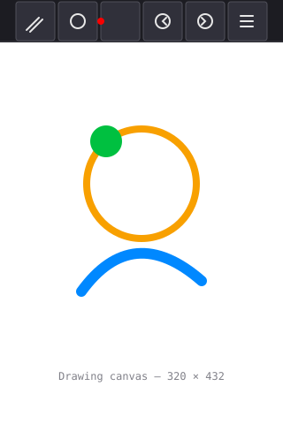
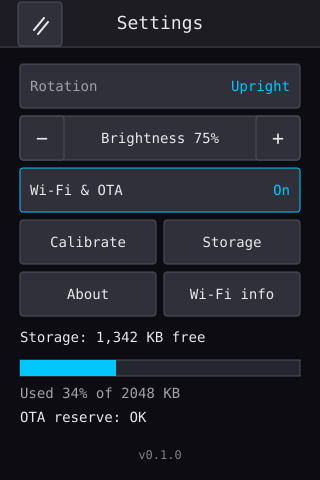
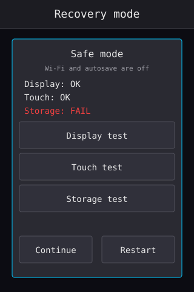

# Pico Paint user guide

Pico Paint is a small offline drawing tablet built on a **Raspberry Pi Pico 2 W**
with a 4" **ILI9488 320×480 portrait** display and a resistive touch panel. It
boots straight into a canvas, saves drawings to internal flash, and uses Wi-Fi
only for optional over-the-air updates.

The illustrations in this guide are UI mockups, not photographs of the panel.

## Quick start

1. Power the Pico over USB. The splash screen shows the palette mark, the
   firmware version and **Hold to skip**.
2. Wait for the splash to finish, or hold a finger on the screen to skip it.
   The canvas opens with white paper and the top bar visible.
3. Draw with a finger or a soft stylus. The default tool is a brush with the
   selected colour and size.
4. Tap the menu button (far right of the top bar) to save, open the gallery or
   change settings.

The app never requires Wi-Fi for drawing, saving, loading or calibration.



## The top bar

The top bar is 48 px high and contains six 44×44 touch targets:

| Button | Action |
|---|---|
| Brush icon | Open the tool sheet: brush, eraser, line, rectangle, ellipse, fill and eyedropper |
| Size dots | Choose a brush size from 1 to 32 px |
| Colour circle | Open the palette, recent colours or the HSV picker |
| Undo arrow | Undo the last action; disabled when there is nothing to undo |
| Redo arrow | Redo the last undone action; disabled when there is nothing to redo |
| Menu lines | New canvas, Save, Save as, Gallery, Settings, Wi-Fi & OTA, About |

Drawing is clipped to the white canvas below the top bar. Releasing a shape
outside the canvas cancels the preview; releasing a freehand stroke at the edge
clips it to the canvas.

## Tools and colour

- **Brush** paints with the current colour and size.
- **Eraser** paints paper white.
- **Line**, **Rectangle** and **Ellipse** show a live preview while you drag.
  The **Outline/Filled** option is available for rectangle and ellipse.
- **Fill** floods the connected area under your finger with the current colour.
  Very complex fills may be refused with `Fill area too complex` and leave the
  canvas unchanged.
- **Eyedropper** picks the colour under your finger.

The palette has 24 swatches, five recent colours and an HSV picker. In the HSV
picker, drag inside the hue bar and the saturation/value square, then tap
**Use** to apply the preview or **Cancel** to leave the previous colour.

## Saving and the gallery

- **Save** overwrites the current file. If the drawing has no name yet, Pico
  Paint opens **Save as** instead.
- **Save as** proposes the next free `imgNNNN.pnt` name and asks for
  confirmation.
- **Gallery** shows up to four drawings per page with thumbnails and names.
  Tap a drawing to open the load confirmation. If the current canvas has
  unsaved changes, the confirmation warns you first.
- Long-press a gallery item to open the delete confirmation.
- **New canvas** asks before clearing the drawing and undo history.

Drawings are stored as `.pnt` files in LittleFS. A 15 s autosave protects a
dirty drawing. If the device resets unexpectedly, the next boot offers
**Restore** or **Discard** for the last autosave.

## Settings

Open **Menu → Settings**.



| Setting | What it does |
|---|---|
| **Rotation** | Switches between upright and 180°-flipped portrait. Tap the row to flip. Landscape is not supported. |
| **Brightness** | Four steps: 25%, 50%, 75% and 100%. The value is saved immediately. |
| **Wi-Fi & OTA** | Turns the wireless/OTA subsystem on or off. The choice is saved and applied immediately, then restored on boot. It is disabled when no credentials are configured or when storage is too low to enable OTA. |
| **Calibrate** | Starts the four-corner touch calibration. Tap each crosshair firmly and the transform is saved to `/config.bin`. |
| **Storage** | Opens storage details: mount status, total/used/free space, file count and the OTA reserve. |
| **About** | Shows firmware, build and hardware information. |
| **Wi-Fi info** | Opens the full Wi-Fi & OTA status screen. |

Storage keeps a **700 KB** reserve for OTA staging. Drawings can still be saved
below that reserve, but the app warns `OTA low` and the OTA server stays paused
until space is freed.

### Rotation and touch

Only the two portrait orientations are supported: **upright** and **flipped**.
Calibration is stored in the upright orientation and flipped automatically when
the display is upside down, so recalibration is not needed after changing
rotation.

### Idle and wake

- After **60 seconds** without touch, the backlight dims.
- After **5 minutes**, the backlight turns off.
- Touch the screen to wake it. The first press while the screen is off only
  wakes the display, so it cannot accidentally press a hidden button.
- Calibration, the recovery self-tests and an active OTA keep the display awake.

## Wi-Fi and OTA

Wi-Fi is optional. See **[OTA updates](ota.md)** for credentials, the upload
command and Windows/WSL notes.

The Wi-Fi & OTA screen shows:

- whether credentials are configured;
- the connection state, IP address, hostname and OTA port;
- signal strength;
- whether the update server is listening or paused;
- the last OTA error;
- a toggle for the radio and OTA server.

The device stays usable offline. Enabling Wi-Fi never blocks painting, and a
failed update returns to the canvas with a toast while keeping the drawing.

## Recovery mode

Pico Paint can enter a small recovery/safe mode in two ways:

1. **Hold a finger on the touch panel while powering on.**
2. **Three consecutive boots that do not stay healthy for five seconds.** The
   boot-health counter is kept in `/boot.health`; a normal boot clears it after
   five seconds.

Recovery mode skips Wi-Fi and autosave so the device can be diagnosed without
networking or background writes.



| Action | What it does |
|---|---|
| **Display test** | Shows full-width red, green, blue, yellow, white and black bands. Tap **Back** to return. |
| **Touch test** | Draws a crosshair at the last touch and shows the mapped `x/y` and raw controller values. Tap **Back** to return. |
| **Storage test** | Opens the normal storage details page. The back button returns to recovery mode. |
| **Continue** | Continues to the canvas. The boot-health counter is cleared, but Wi-Fi and autosave stay off for the rest of this boot. |
| **Restart** | Clears the boot-health counter and reboots normally. |

If the device is stuck in a boot loop, recovery mode lets you confirm that the
display, touch panel and filesystem are responding before reflashing over USB.

## Troubleshooting

| Symptom | Check |
|---|---|
| Drawings do not save | Settings → Storage must show mounted storage. `Storage unavailable` means the LittleFS partition did not mount; reflash over USB. |
| Touch is offset | Run Settings → Calibrate and tap each crosshair firmly. |
| Touch feels upside down after changing rotation | The app flips calibration automatically; if it is still wrong, recalibrate in the current rotation. |
| Screen is dark | Touch it to wake. After 5 minutes the backlight turns off; this is not a reset. |
| Wi-Fi toggle is disabled | Add credentials in `include/secrets.h` and rebuild, or free space so at least 700 KB is available for OTA. |
| OTA refuses to start | The storage reserve is low, the device is offline, or the OTA server is disabled. See [OTA updates](ota.md). |
| Device loops at boot | Hold touch at power-on for recovery mode, then run the three self-tests. If storage still fails, reflash over USB in BOOTSEL mode. |
| Device is completely unresponsive | Unplug it, hold BOOTSEL while reconnecting, and flash the USB build. Gallery and settings normally survive a USB reflash. |

## Building and flashing

The repository README has the current PlatformIO environments and build
commands. The short version:

```bash
pio run -e pico2w_usb                 # build USB/recovery image
pio run -e pico2w_usb -t upload       # first flash over USB
pio run -e pico2w_ota -t upload       # later updates over Wi-Fi
pio test -e native                    # host unit tests
```

For WSL2 OTA uploads, use `tools/ota_windows.sh` as described in
[docs/ota.md](ota.md).
